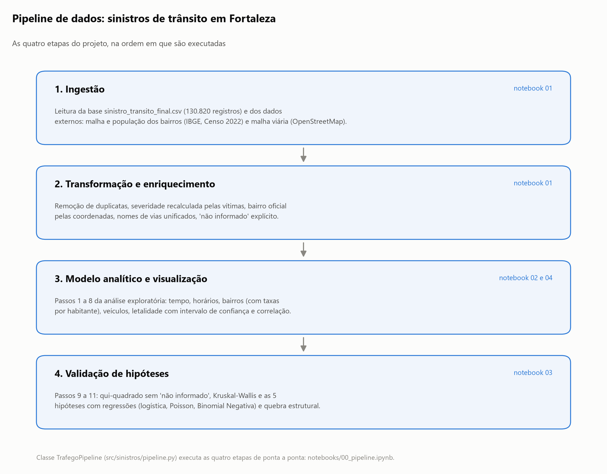

# Sinistros de trânsito em Fortaleza (2015-2024)

Análise exploratória e inferencial dos **130.766 sinistros de trânsito** registrados pela AMC
(Autarquia Municipal de Trânsito de Fortaleza) entre 2015 e 2024: quando, onde, com quais veículos
e em que condições os acidentes acontecem e, principalmente, quando matam.

Projeto do curso de Ciência de Dados (IFCE).

## Principais resultados

| | Resultado |
|---|---|
| **Mortes** | Caem de forma contínua: 255 em 2015, 140 em 2024 (−6,6% ao ano). |
| **Acidentes** | Não caem aos poucos: há um **degrau em janeiro de 2018** (de ~1.450 para ~960 por mês), provavelmente uma mudança no registro, a confirmar com a AMC. |
| **Madrugada do fim de semana** | Morrem 1,7 vez mais pessoas por dia que na madrugada de dia útil (15,8 contra 9,5 mortos a cada 100 dias). O número de acidentes é quase igual; o que aumenta é a gravidade. |
| **Veículos** | Com moto, 96,5% dos acidentes têm vítima (60% sem moto). Ônibus, caminhão e bicicleta tornam o acidente 3 a 4 vezes mais letal que só com carros. |
| **Natureza** | Atropelamentos são 38% dos acidentes fatais. |
| **Bairros** | População e malha viária explicam ~40% das diferenças. O Centro tem 4,2 vezes os acidentes esperados; Aldeota, Meireles e outros polos de comércio, 2,3 a 2,7 vezes. |
| **Vias** | Av. Washington Soares / CE-040 (o mesmo corredor) lidera em acidentes; a **BR-116** lidera em mortes (140, quase o dobro da segunda). |
| **Controle de tráfego** | Associação fraca com a gravidade, mas locais sem controle têm 62% mais chance de acidente fatal que semáforos (só 39% da base tem a informação). |

Relatórios: [relatorios/relatorio_executivo.pdf](relatorios/relatorio_executivo.pdf) (gerencial) e
[relatorios/passos_analise.pdf](relatorios/passos_analise.pdf) (passo a passo técnico).

## Dashboard

Dashboard interativo em Streamlit, com 6 páginas (Visão geral, Quando, Mapa, Bairros e vias,
Veículos, Hipóteses), tema claro e escuro e layout adaptado a computador, tablet e celular.

**Rodar localmente** (a partir da raiz do projeto):

```bash
pip install -r dashboard/requirements.txt
streamlit run dashboard/app.py
```

**Publicar no Streamlit Community Cloud:** em [share.streamlit.io](https://share.streamlit.io),
"Create app" → escolha este repositório, branch `main` e o arquivo `dashboard/app.py`. Em
"Advanced settings", selecione Python 3.12. O Cloud instala `dashboard/requirements.txt` e lê o
tema em `.streamlit/config.toml`.

Os dados do dashboard ficam em `dashboard/dados/` e são regenerados pelo pipeline
(`python -m sinistros.pipeline`).

## Estrutura

```
├── dashboard/                   ← dashboard Streamlit (app.py, páginas, dados e logos)
├── notebooks/
│   ├── 00_pipeline.ipynb        ← executa tudo de ponta a ponta (TrafegoPipeline)
│   ├── 01_limpeza.ipynb         ← ingestão, qualidade e limpeza
│   ├── 02_exploratoria.ipynb    ← passos 1 a 8
│   ├── 03_inferencia.ipynb      ← passos 9 a 11 (5 hipóteses), conclusões e limitações
│   └── 04_vias_mapa.ipynb       ← ranking de vias e mapas
├── src/sinistros/               ← código reutilizado pelos notebooks e pelo pipeline
│   ├── pipeline.py              ← classe TrafegoPipeline (mesmas 6 etapas da versão original)
│   ├── limpeza.py               ← tratamento da base, com registro de cada decisão
│   ├── vias.py                  ← padronização dos nomes de vias
│   ├── externos.py              ← download dos dados do IBGE e do OpenStreetMap
│   ├── analises.py              ← uma função por passo e por hipótese
│   ├── estatistica.py           ← testes e modelos
│   ├── graficos.py              ← todas as figuras, com estilo único
│   ├── mapas.py                 ← mapa interativo (Folium)
│   └── config.py                ← caminhos e constantes
├── scripts/
│   ├── baixar_dados_externos.py
│   └── gerar_relatorios.py      ← gera os PDFs a partir de resultados/resultados.json
├── dados/
│   ├── brutos/                  ← sinistro_transito_final.csv (base recebida)
│   ├── externos/                ← bairros e população (IBGE 2022), malha viária (OSM)
│   └── processados/             ← base tratada (.parquet), log da limpeza, mapeamento de vias
├── figuras/                     ← todos os gráficos (numerados na ordem da apresentação)
│   └── mapas/                   ← mapa estático das vias e mapa_interativo.html
├── resultados/resultados.json   ← números-chave de todas as análises
├── relatorios/                  ← PDFs
└── legado/                      ← versão anterior do projeto (notebooks, PDFs, planilha de vias)
```

## Como executar

Requer Python 3.11 ou mais recente.

```bash
python -m venv .venv
.venv\Scripts\activate            # Windows  (Linux/Mac: source .venv/bin/activate)
pip install -r requirements.txt
```

Depois, abra e execute `notebooks/00_pipeline.ipynb`, ou, pelo terminal, a partir da raiz:

```bash
$env:PYTHONPATH = "src"           # PowerShell  (cmd: set PYTHONPATH=src; Linux/Mac: export PYTHONPATH=src)
python -m sinistros.pipeline      # limpeza, análises, gráficos e resultados.json (~30 s)
python scripts/gerar_relatorios.py
```

Os dados externos já estão em `dados/externos/`. Para baixá-los de novo (IBGE e OpenStreetMap,
alguns minutos): `python scripts/baixar_dados_externos.py`.

## Pipeline



A classe `TrafegoPipeline` mantém os mesmos seis métodos da versão original:

| Fase | Método | Conteúdo |
|---|---|---|
| 1-2. Ingestão, transformação e enriquecimento | `etapa_1_ingestao` | leitura, dados externos, limpeza |
| 3. Modelo analítico e visualização | `etapa_2_analise_descritiva` | passos 1 a 3 |
| | `etapa_3_analise_espacial` | passo 4, vias e mapas |
| | `etapa_4_veiculos_coocorrencia` | passos 5 a 8 |
| 4. Validação de hipóteses | `etapa_5_testes_inferenciais` | passos 9 e 10 |
| | `etapa_6_verificacao_hipoteses` | passo 11 (H1 a H5) |

## Decisões de tratamento dos dados

Registradas em `dados/processados/log_limpeza.csv` e detalhadas em `notebooks/01_limpeza.ipynb`.

- **Duplicatas:** 54 linhas idênticas em todas as colunas removidas.
- **Severidade** recalculada pelas vítimas (fatal: houve morto; ferido: houve ferido; ileso: só
  ilesos). Corrige 3.434 acidentes "ilesos" com feridos e preenche 8.167 "não informado".
- **Veículos:** 11.969 acidentes (9%) com todas as colunas de veículo zeradas, inclusive colisões,
  são tratados como "veículo não informado" e ficam fora das análises por veículo.
- **"Não informado"** fica explícito e é excluído dos testes. Ele cresce com o tempo: o controle de
  tráfego falta em 36% dos registros de 2015 e em mais de 80% desde 2021.
- **Bairro** reatribuído pelas coordenadas com a malha oficial do IBGE 2022, compatível com a
  população do Censo.
- **Vias:** 11.502 grafias unificadas em 6.227 vias (abreviações, complementos, erros de
  digitação). Nomes diferentes do mesmo corredor, confirmados pelas coordenadas, viram uma via só:
  CE-040 = Av. Washington Soares; BR-222 = Av. Mister Hull. Mapeamento completo em
  `dados/processados/vias_mapeamento_nomes.csv`.

## O que mudou em relação à versão anterior

| Ponto | Antes | Agora |
|---|---|---|
| H5 (bairros) | R² = 0,95 usando as motos envolvidas nos próprios acidentes (circular) | Binomial Negativa com população (IBGE) e malha viária (OSM): pseudo-R² ≈ 0,4 |
| H4 / qui-quadrado | "Não informado" como categoria: V = 0,24 | Sem ele: V = 0,05; efeito específico de "sem controle" com regressão logística |
| H1 | "Madrugada OU fim de semana" num grupo, V = 0,03 | Madrugada do fim de semana comparada com a de dia útil: mortes por dia, letalidade e regressão ajustada |
| H3 | Reta única, "queda contínua" | Quebra estrutural em jan/2018; tendência das mortes |
| H2 | ANOVA em contagens | Poisson com erros robustos |
| Passo 10 | R² feridos × severidade (tautológico) | Kruskal-Wallis entre variáveis independentes |
| Passo 6 | Diagonal descrita como "exclusivamente" | Diagonal = acidentes só com aquele veículo |
| Passo 7 | Taxas sem incerteza | Intervalos de confiança; amostras pequenas sinalizadas |
| Passo 8 | Pearson | Spearman |
| Vias | Planilha à parte com nomes duplicados; mapa com coordenadas digitadas à mão | Ranking da base completa; mapas com as coordenadas reais |
| Relatório | Português de Portugal | Português do Brasil, gerado dos resultados |

## Limitações

- A base cobre acidentes **registrados**; acidentes sem vítima tendem a ser sub-registrados.
- O critério de registro parece ter mudado em janeiro de 2018.
- Controle de tráfego e uso do solo faltam na maior parte dos registros recentes.
- Não há fluxo de veículos por via ou bairro; a população residente é uma medida parcial de exposição.
- Os testes mostram **associações**: álcool, velocidade e condições da via não estão nos dados.

## Fontes

- Sinistros: AMC / Prefeitura de Fortaleza (base tratada `sinistro_transito_final.csv`).
- Bairros e população: IBGE, Censo Demográfico 2022, malha de bairros e agregados por bairro.
- Malha viária: © colaboradores do OpenStreetMap (ODbL).
